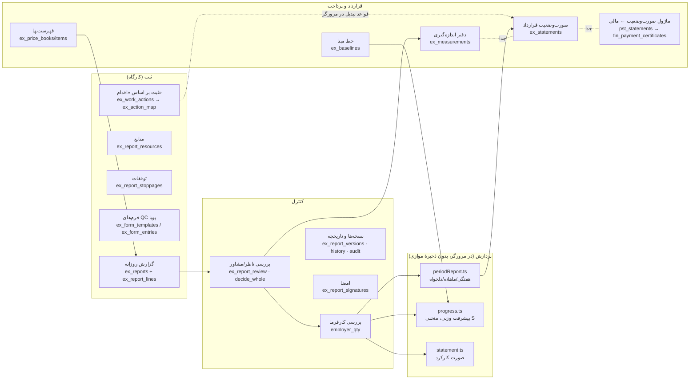

# گزارش کمیتهٔ خبرگان — ماژول مدیریت اجرای فرین

**فازهای A تا C: شناخت، آزمون عملیاتی و ارزیابی** · تاریخ: ۲۸ آبان ۱۴۰۵

> وضعیت: فازهای A (شناخت)، B (آزمون عملیاتی روی محیط مستقل) و C (ارزیابی و معماری پیشنهادی) انجام شده است.
> فاز D (پیاده‌سازی) برای دو ایراد بحرانی به **تصمیم شما** نیاز دارد. علت این است که اصلاح آن‌ها پایگاه دادهٔ عملیاتی و موتور صورت‌وضعیت را تغییر می‌دهد (بخش ۹).
> در این مرحله هیچ تغییری روی پایگاه دادهٔ عملیاتی یا کد برنامه انجام نشده است.

---

## ۱. خلاصهٔ مدیریتی

ماژول مدیریت اجرا از آنچه دستور مأموریت فرض کرده کامل‌تر است. هستهٔ زنجیرهٔ «گزارش روزانه ← تأیید ← تجمیع ← صورت‌وضعیت» وجود دارد و در آزمون واقعی درست کار کرد.

**نتیجهٔ آزمون عملیاتی:** آزمون روی یک پایگاه دادهٔ مستقل، با ۳۲ گزارش روزانه و ۲۰۱ ردیف فعالیت در ۳۷ روز، اجرا شد. **از ۱۲ سناریو، ۱۰ مورد موفق و ۲ مورد ناموفق بود.** هر دو مورد ناموفق در **مسیر صورت‌وضعیت** هستند و بحرانی‌اند:

| # | ایراد | اثر |
|---|---|---|
| **C1** | سرور مقدار «سیستمی» و «فی» صورت‌وضعیت را همان‌طور که مرورگر می‌فرستد ذخیره می‌کند و آن را با مقادیر تأییدشده مقایسه نمی‌کند. | در آزمون، پیمانکار صورت‌وضعیتی با **۳ برابر مقدار و ۲ برابر فی** ساخت و سرور آن را پذیرفت. این ایراد مستقیم روی پرداخت اثر دارد. |
| **C2** | در حالت «تأیید الزامی کارفرما»، صفحهٔ صورت‌وضعیت قرارداد مقدار تأییدشدهٔ کارفرما را لحاظ نمی‌کند. | در آزمون، صورت‌وضعیت **۱٬۴۵۱ سرجوش** را مبنا گرفت؛ کارفرما فقط **۳۷۴** سرجوش را تأیید کرده بود. پیشرفت فیزیکی همین حالت را درست حساب می‌کند (۴٫۴۹٪). |

**بخش‌هایی که در آزمون درست کار کردند:**
- گزارش هفتگی و ماهانه بدون ورود مجدد اطلاعات ساخته می‌شوند. اعداد با محاسبهٔ مستقل SQL **صفر مغایرت** داشتند، از جمله در مرز ماه شمسی (شهریور، مهر و آبان).
- تفکیک سطوح گزارش‌شده / تأیید ناظر / تأیید کارفرما / اندازه‌گیری / قابل‌پرداخت / پرداخت‌شده در ساختار داده وجود دارد.
- گردش ثبت، ارسال، برگشت، اصلاح، تأیید و بازگشایی مجاز درست کار کرد. **نسخهٔ قبلی هر تغییر** محفوظ می‌ماند.
- کنترل‌های سقف مقدار پیمان، ردیف تکراری و دسترسی نقش‌ها درست عمل کردند.
- هر عدد ماهانه تا گزارش روزانهٔ منبع قابل ردیابی است (۱۰۰٪).

**ایرادهای مهم دیگر** (جزئیات در بخش ۶):
1. کدهای SQL مخزن با پایگاه دادهٔ عملیاتی هم‌خوان نیستند: ۳۸ تابع گزارش و صورت‌وضعیت فقط روی پایگاه دادهٔ عملیاتی تغییر کرده‌اند.
2. سه مسیر موازی برای صورت‌وضعیت وجود دارد و به هم وصل نیستند.
3. موتور گزارش‌ساز قالب‌محور با کنترل مدارک ISO هنوز وجود ندارد.
4. اصلاح یک ردیف، کل گزارش را بازگشایی می‌کند.

---

## ۲. روش اجرا

| فاز | کار انجام‌شده | تغییر در پایگاه دادهٔ عملیاتی |
|---|---|---|
| A — شناخت | بررسی ۲۸ صفحه، ۵۸ جدول `ex_*`، ۹۱ تابع پایگاه داده، فایل‌های SQL ۰۰۱ تا ۰۴۵ و کتابخانه‌های محاسبه | خیر (فقط خواندن) |
| B — آزمون | ساخت پایگاه دادهٔ **مستقل** در Docker با Supabase Postgres 17 (همان نسخهٔ سرور جدید) از روی فایل‌های مخزن و نسخهٔ عملیاتی توابع گزارش. ورود داده با **نقش واقعی هر کاربر**، به‌طوری که امنیت سطر و کنترل‌ها هم فعال بودند. | خیر |
| C — ارزیابی | اجرای همان کد محاسبهٔ برنامه روی داده‌های پایگاه داده و مقایسه با جمع مستقل SQL | خیر |

**تکرارپذیری:** همهٔ ابزارها در `supabase/tests/execution_e2e/` قرار دارند:

```
bash supabase/tests/execution_e2e/build_test_db.sh   # ساخت پایگاه دادهٔ آزمون (حدود ۸۰ ثانیه)
bash supabase/tests/execution_e2e/run.sh             # اجرای ۱۲ سناریو → JSON
```

نتیجهٔ خام آزمون در `results_before_fix.json` است.

---

## ۳. وضعیت موجود (As-Is)

### ۳-۱. نقشهٔ معماری



### ۳-۲. فهرست قابلیت‌ها

| حوزه | قابلیت موجود | وضعیت |
|---|---|---|
| گزارش روزانه | چند فعالیت در یک گزارش، جبههٔ کاری، محل/کیلومتر، شیفت، منابع انسانی و تجهیزات (فعال/بیکار/مرخصی/تعمیر)، توقف با علت، یادداشت، عکس، پیش‌نویس، پیشنهاد از روز قبل | ✅ |
| فرم‌های پویا | کاتالوگ فرم‌های QC از روی کاربرگ‌های واقعی، قالب‌های طراحی‌شده و تأییدشده، ثبت «بر اساس اقدام» با فیلدهای خود اقدام | ✅ جزئی (برای پروژهٔ ایستگاه هنوز الگو تعریف نشده) |
| گردش تأیید | پیش‌نویس ← ارسال ← تأیید/رد/برگشت هر ردیف یا کل گزارش ← بازگشایی با دلیل ← امضای نقش‌ها ← گام کارفرما (خاموش/مشورتی/الزامی) | ✅ |
| سوابق | نسخهٔ کامل گزارش در هر تغییر وضعیت، تاریخچهٔ اقدام‌ها، ممیزی تغییر هر سطر | ✅ |
| کنترل‌ها | سقف مقدار پیمان، ردیف تکراری، قفل گزارش ارسال‌شده، امنیت سطر برای نقش‌ها | ✅ |
| تجمیع | هفتگی، ماهانهٔ شمسی، بازهٔ دلخواه، ماتریس روزانه، تفکیک پیمانکار/جبهه/ایستگاه/کیلومتر، منابع، توقفات | ✅ |
| پیشرفت | وزنی با گروه‌های وزنی، خط مبنا با نسخه، منحنی S برنامه/واقعی، عوامل انحراف | ✅ |
| زمان‌بندی | جدول ورود برنامه (ex_schedule_imports)، پیش‌نگری (lookahead)، وابستگی فعالیت‌ها، پیوند به ماژول زمان‌بندی | ⚠️ جزئی (اتصال چند‌به‌چند فعالیت اجرایی به فعالیت P6 کامل نیست) |
| صورت‌وضعیت | صورت کارکرد، صورت‌وضعیت قرارداد (سیستمی/درخواست پیمانکار/نظر مشاور)، دفتر اندازه‌گیری، ماژول صورت‌وضعیت با ارسال به مالی | ⚠️ ایراد C1 و C2؛ سه مسیر جدا |
| خروجی | Excel برای گزارش‌های دوره‌ای، صورت‌وضعیت و تأخیرات؛ چاپ کاغذ فرم؛ بایگانی نسخهٔ صادرشده با سربرگ | ⚠️ موتور قالب و کنترل مدرک ISO ندارد |
| تحلیل | داشبورد، بهره‌وری، تأخیرات و ادعا، پیش‌بینی پایان، شکاف‌ها | ✅ (drill-down کامل از ماه تا روز فقط در جدول‌هاست) |

### ۳-۳. نقاط قوت قابل حفظ
1. **منبع واحد داده.** همهٔ اعداد تجمعی هنگام نمایش از ردیف‌های روزانه محاسبه می‌شوند و ذخیرهٔ موازی وجود ندارد. سناریوهای S02، S03 و S12 مغایرت صفر نشان دادند.
2. **مقادیر روزانه و تجمعی جدا هستند.** گزارش ماهانه از جمع مقادیر افزایشی ساخته می‌شود، نه از جمع ستون‌های تجمعی.
3. **کنترل‌های سمت سرور قوی هستند:** قفل گزارش، تغییر فقط از راه توابع مجاز، سقف پیمان، ردیف تکراری و امنیت سطر.
4. **سابقه کامل است.** از هر تغییر وضعیت نسخه گرفته می‌شود (S08: نسخهٔ ۶۷ و ۶۳ سرجوش هر دو محفوظ ماندند).

---

## ۴. نتایج آزمون عملیاتی

**پروژهٔ آزمون:**
- خط انتقال گاز ۴۸ اینچ، بخش ۳۰ کیلومتری، با ۳ جبههٔ کاری و ۸ فعالیت (از تسطیح حریم تا خاکریزی)، همه با وزن و فی.
- بازهٔ آزمون ۳۰ شهریور تا ۴ آبان ۱۴۰۵ (۳۷ روز). جمعه‌ها بدون گزارش بودند و **۳۲ گزارش روزانه** ثبت شد.
- رویدادها: بارندگی، نرسیدن مصالح، خرابی سایدبوم، کمبود جوشکار، بهبود تدریجی بهره‌وری و جابه‌جایی جبهه.

| کد | سناریو | ورودی | نتیجهٔ مورد انتظار | نتیجهٔ واقعی | وضعیت |
|---|---|---|---|---|---|
| S01 | ثبت داده در پایگاه داده | ۳۷ روز | ≥۳۰ گزارش | ۳۲ گزارش (۲۹ تأییدشده، ۲ در انتظار، ۱ پیش‌نویس)، ۲۰۱ ردیف، ۲۸۸ ردیف منابع، ۵ توقف | ✅ |
| S02 | گزارش هفتگی | ۶ هفته | جمع هفته‌ها = جمع تأییدشده؛ پیوستگی تجمعی | مغایرت صفر در هر ۸ فعالیت | ✅ |
| S03 | ماهانه با مرز ماه شمسی | شهریور، مهر، آبان | برابر با SQL مستقل | جوشکاری مهر ۱۴۵۵ = SQL ۱۴۵۵؛ آبان ۶۰ = ۶۰ | ✅ |
| S04 | منابع و توقفات ماه | مهر | خلاصهٔ میانگین و ساعات | ۹ نوع منبع؛ ۴ علت توقف با ساعات | ✅ |
| S05 | تفکیک سطوح | همهٔ ردیف‌ها | ستون‌های مستقل | مثال جوشکاری: گزارش‌شده ۱۷۳۵، تأیید ناظر ۱۵۱۵، تأیید کارفرما ۳۷۴ | ✅ |
| S06 | رد، کسر، برگشت | دو گزارش | رد=۰، کسر با یادداشت، سابقه | کسر ۶ سرجوش با دلیل؛ ردیف رادیوگرافی رد شد؛ ۴ نسخه و تاریخچهٔ کامل | ✅ |
| S07 | کنترل‌ها و دسترسی | ۶ تلاش غیرمجاز | همه رد شوند | سقف پیمان، ردیف تکراری، بیننده، تأیید توسط پیمانکار و ویرایش ردیف تأییدشده همه رد شدند | ✅ |
| S08 | اصلاح گزارش تأییدشده | بازگشایی ← ۶۷ به ۶۳ ← تأیید | ماهانه −۴؛ نسخهٔ قبلی محفوظ | ۱۴۵۵ ← ۱۴۵۱؛ ۵ نسخه | ✅ |
| S09 | اندازه‌گیری ← قابل‌پرداخت ← پرداخت | جوشکاری مهر | قواعد ترتیب سطوح رعایت شود | اندازه‌گیری بیش از تأییدشده و قابل‌پرداخت بیش از اندازه‌گیری رد شدند؛ پیمانکار نتوانست اندازه‌گیری ثبت کند | ✅ |
| **S10** | **صورت‌وضعیت مهر** | ساخت از تأییدشده‌ها، سپس مقدار جعلی | مقدار جعلی رد شود | ساخت عادی درست بود، اما **مقدار ×۳ و فی ×۲ پذیرفته شد** | ❌ C1 |
| **S11** | **گام الزامی کارفرما** | `employerStep = binding` | صورت‌وضعیت = تأیید کارفرما | **۱۴۵۱ به‌جای ۳۷۴** | ❌ C2 |
| S12 | ردیابی تا منبع | جوشکاری مهر | جمع منابع = عدد گزارش | ۱۴۵۱ = ۱۴۵۱ (۲۴ گزارش منبع) | ✅ |

**علت ریشه‌ای C1:** تابع `ex_statement_create` و `ex_statement_refresh` مقادیر `sys`، `unit_price` و `base_qty` را بدون بررسی از ورودی مرورگر ذخیره می‌کنند. صفحهٔ صورت‌وضعیت همچنین فی **جاری** فعالیت را می‌فرستد، نه فی **نسخهٔ خط مبنای معتبر در آن تاریخ**.

**علت ریشه‌ای C2:** در `ContractStatementPage.tsx` (خط ۴۰ و ۱۰۴) و `ExecutionPulse`، `ReviewPage` و `MgmtReportPage`، تابع `cumulative()` بدون گزینهٔ `employer` فراخوانی می‌شود.

---

## ۵. شاخص‌های پذیرش

| شاخص | معیار | نتیجهٔ اندازه‌گیری‌شده |
|---|---|---|
| زمان ثبت گزارش روزانهٔ معمولی | ≤ ۳ دقیقه | **هنوز اندازه‌گیری نشده.** پیش‌شرط آن نصب کامل Supabase در محیط آزمون است (ورود و API) و در فاز E انجام می‌شود. ساختار صفحه (پیشنهاد از روز قبل، چند ردیف در جدول، پیش‌نویس) هدف را ممکن می‌کند. |
| ورود مجدد برای گزارش هفتگی | صفر | ✅ صفر |
| ورود مجدد برای گزارش ماهانه | صفر | ✅ صفر |
| مغایرت احجام تجمیعی | صفر | ✅ صفر (S02، S03، S12) |
| ردیابی تا منبع | ۱۰۰٪ | ✅ ۱۰۰٪ برای اعداد گزارش؛ ❌ برای صورت‌وضعیت (C1) |
| تفکیک سه سطح | ۱۰۰٪ | ✅ در ساختار؛ ❌ در صورت‌وضعیت حالت الزامی (C2) |
| PDF و Excel | الزامی | ⚠️ Excel و چاپ وجود دارد؛ PDF استاندارد با شمارهٔ مدرک وجود ندارد |
| گردش تأیید و اصلاح | الزامی | ✅ |
| حفظ سوابق و نسخه‌ها | الزامی | ✅ |
| فرم‌های پویا | الزامی | ⚠️ جزئی |
| استفاده در موبایل | الزامی | ⚠️ در فاز E با مرورگر آزمون می‌شود |
| صورت‌وضعیت آزمایشی | الزامی | ✅ ساخته شد؛ ❌ دو ایراد بحرانی |
| انطباق با قالب ISO | الزامی | ❌ هنوز پیاده نشده |

---

## ۶. یافته‌های کمیته به تفکیک تخصص و اولویت

### بحرانی (Critical)

| # | عنوان | تخصص | محل | راهکار | پیچیدگی |
|---|---|---|---|---|---|
| C1 | سرور مقدار و فی صورت‌وضعیت را بدون کنترل می‌پذیرد | صورت‌وضعیت، پایگاه داده | `ex_statement_create/refresh` | محاسبهٔ مقدار سیستمی **روی سرور** از ردیف‌های تأییدشده، شامل قواعد تبدیل «اقدام به ردیف پیمان». فی و مقدار پیمان از نسخهٔ خط مبنای معتبر خوانده می‌شود و ورودی مرورگر فقط فهرست ردیف‌ها را تعیین می‌کند. | متوسط |
| C2 | گام الزامی کارفرما در صورت‌وضعیت و چند صفحه لحاظ نمی‌شود | مدیریت قرارداد | ۵ فراخوانی `cumulative()` | پس از C1، صورت‌وضعیت از سرور می‌آید. بقیهٔ فراخوانی‌ها هم گزینهٔ کارفرما را می‌گیرند. | کم |

### مهم (Major)

| # | عنوان | تخصص | راهکار |
|---|---|---|---|
| M1 | ۳۸ تابع و چند تریگر عملیاتی با فایل‌های مخزن متفاوت است. مخزن منبع معتبر پایگاه داده نیست و بازسازی پایگاه داده از روی آن نتیجهٔ متفاوت می‌دهد. | معماری | گرفتن اسنپ‌شات کامل طرح‌وارهٔ پایگاه داده (روی سرور جدید با `pg_dump --schema-only`) در مخزن، و از این به بعد هر تغییر فقط با فایل migration |
| M2 | سه مسیر صورت‌وضعیت (صورت کارکرد، صورت‌وضعیت قرارداد، ماژول صورت‌وضعیت ← مالی) جدا هستند. دفتر اندازه‌گیری هم به صورت‌وضعیت نمی‌رسد. | قرارداد، صورت‌وضعیت | زنجیرهٔ واحد: تأییدشده ← اندازه‌گیری ← قابل‌پرداخت ← صورت‌وضعیت ← گواهی مالی. مبنای پرداخت سطح «اندازه‌گیری/قابل‌پرداخت» باشد، نه «تأییدشده». |
| M3 | موتور گزارش‌ساز قالب‌محور و کنترل مدرک ISO وجود ندارد. شمارهٔ مدرک، بازنگری، تهیه/کنترل/تأیید، وضعیت مدرک، تاریخچهٔ بازنگری و توزیع پوشش داده نشده‌اند. | BI، کنترل مدارک | موتور قالب (بخش ۷-۹) روی بایگانی موجود `ex_report_archive` |
| M4 | اصلاح یک ردیف، **کل** گزارش را بازگشایی می‌کند و همهٔ ردیف‌ها تا تأیید مجدد از آمار خارج می‌شوند (S08: −۶۷ به‌جای −۴). | برنامه‌ریزی و کنترل | اصلاحیهٔ سطح ردیف با مجوز (ردیف جدید منفی/مثبت با ارجاع به ردیف اصلی) |
| M5 | اتصال چند‌به‌چند فعالیت اجرایی و فعالیت برنامهٔ P6 و مقایسهٔ انحراف در سطح فعالیت برنامه کامل نیست. | برنامه‌ریزی | جدول پیوند با ضریب سهم و همگام‌سازی با ماژول زمان‌بندی |
| M6 | الگوی گزارش روزانهٔ «ایستگاه» (سیویل، مکانیکال، پایپینگ، برق، ابزاردقیق، پیش‌راه‌اندازی) تعریف نشده است. | مدیریت ساخت | الگوهای آماده در کاتالوگ فرم‌ها |

### توسعه‌ای (Enhancement)
- **E1** پیشنهاد خودکار مقدار از روند ۵ روز گذشته و هشدار ناهنجاری، مثل پرش مقدار بدون منابع کافی.
- **E2** drill-down نموداری: از ماه به جبهه، سپس فعالیت و روز، در داشبورد.
- **E3** اندازه‌گیری بهره‌وری بر حسب نفر-ساعت در واحد فعالیت، با اتصال منابع گزارش به فعالیت.
- **E4** ارسال خودکار توقف بحرانی به ماژول مسائل و ریسک. پیوند امروز دستی است.

---

## ۷. معماری پیشنهادی (To-Be)

اصل طراحی: **بازنویسی نمی‌شود.** معماری موجود حفظ می‌شود و فقط حلقه‌های ناقص بسته می‌شوند.

1. **ثبت روزانه:** بدون تغییر ساختاری. فقط سنجش زمان ثبت و کاهش کلیک (فاز E).
2. **فرم‌های پویا:** همان کاتالوگ `formCatalog` به‌علاوهٔ `ex_form_templates`. الگوهای «ایستگاه» اضافه می‌شوند (M6).
3. **پایگاه دادهٔ مرکزی:** همان جدول‌ها. M1 (اسنپ‌شات طرح‌واره و migration-only) و M4 (اصلاحیهٔ سطح ردیف) اضافه می‌شوند.
4. **سه سطح اطلاعات:**

   ```
   reported (qty) → verified (approved_qty / employer_qty) → measured → payable (billed) → paid
   ```

   هر سطح ستون یا جدول مستقل دارد و تبدیل خودکار بین سطوح وجود ندارد. این ساختار امروز هم هست؛ فقط باید به صورت‌وضعیت وصل شود.
5. **گردش تأیید:** بدون تغییر. نقش‌ها و مجوزها از `rolePerms` هر پروژه خوانده می‌شوند.
6. **تجمیع:** بدون تغییر. محاسبه هنگام نمایش انجام می‌شود و چیزی ذخیره نمی‌شود. خروجی صادرشده در بایگانی با نسخه ثبت می‌شود.
7. **زمان‌بندی:** جدول پیوند `ex_activity_schedule_links (activity_id, sch_activity_id, share)` برای ارتباط چند‌به‌چند (M5).
8. **صورت‌وضعیت:** تابع سمت سرور `ex_payable_basis(project, until)` منبع واحد مقدار سیستمی، قابل‌پرداخت و فی معتبر می‌شود و هر سه مسیر از آن تغذیه می‌شوند (C1، C2، M2).
9. **گزارش‌ساز:** جدول قالب `ex_report_templates`، شامل بخش‌ها، چیدمان، سربرگ و فیلدهای کنترل مدرک، جدا از منطق داده. صدور هر گزارش با شمارهٔ مدرک و بازنگری در `ex_report_archive` ثبت می‌شود و نسخهٔ قبلی «منسوخ» علامت می‌خورد (M3).
10. **قالب‌های ISO:** قالب‌های بارگذاری‌شده (فرم‌های QC بر اساس کاربرگ) به‌عنوان قالب پایه در اولویت استفاده می‌شوند.
11. **داشبورد:** همان داشبوردهای موجود به‌علاوهٔ drill-down (E2).
12. **اتصال به سایر ماژول‌ها:** از پیوندهای موجود `ex_links` و `ex_raise` استفاده می‌شود و E4 اضافه می‌شود.

---

## ۸. نقشهٔ راه پیاده‌سازی

| مرحله | محتوا | نیاز به تأیید شما |
|---|---|---|
| D1 | **C1 و C2:** محاسبهٔ صورت‌وضعیت روی سرور + اصلاح ۵ فراخوانی + آزمون مجدد S10 و S11 | ✅ تغییر تابع در پایگاه دادهٔ عملیاتی |
| D2 | M1: اسنپ‌شات طرح‌وارهٔ پایگاه داده از سرور جدید در مخزن | خیر |
| D3 | M2 و M4: زنجیرهٔ واحد پرداخت و اصلاحیهٔ سطح ردیف | ✅ تغییر ساختار جدول |
| D4 | M3: موتور گزارش‌ساز و کنترل مدرک ISO | ✅ جدول جدید |
| D5 | M5، M6 و E1 تا E4 | به ترتیب اولویت شما |
| E | آزمون پذیرش کامل: سنجش زمان ثبت روی محیط کامل، موبایل، PDF و تکرار ۱۲ سناریو | خیر |

---

## ۹. تصمیم‌های لازم

1. **اعمال D1 روی پایگاه دادهٔ عملیاتی.** تابع جدید صورت‌وضعیت روی سرور. فایل migration و rollback آماده و آزمون‌شده تحویل می‌شود.
2. **شاخهٔ کاری.** هر push به شاخهٔ فعلی بلافاصله نسخهٔ زندهٔ فرین را به‌روز می‌کند. برای کار این مأموریت یک شاخهٔ جدا لازم است تا تغییرات پیش از تأیید شما روی سامانهٔ زنده نروند.
3. **ترتیب اولویت D3 تا D5.**
